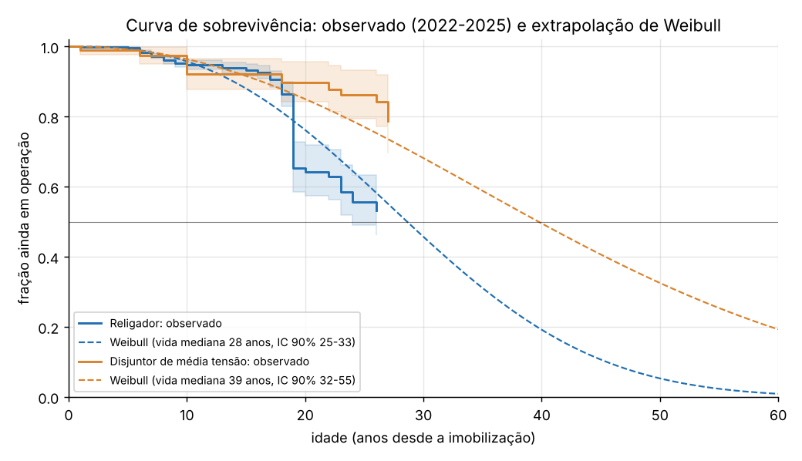
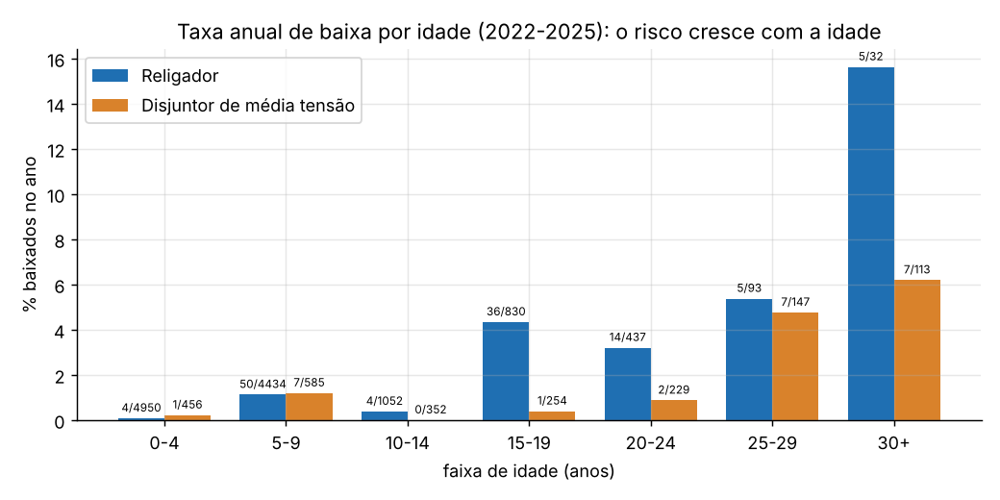
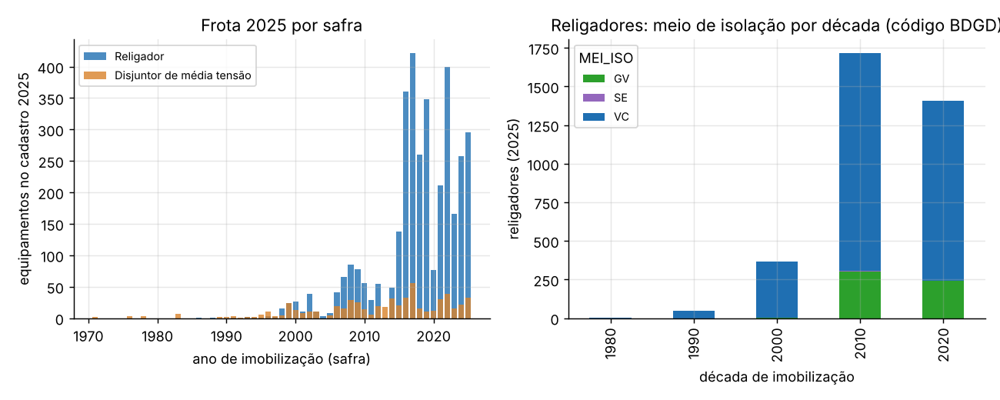
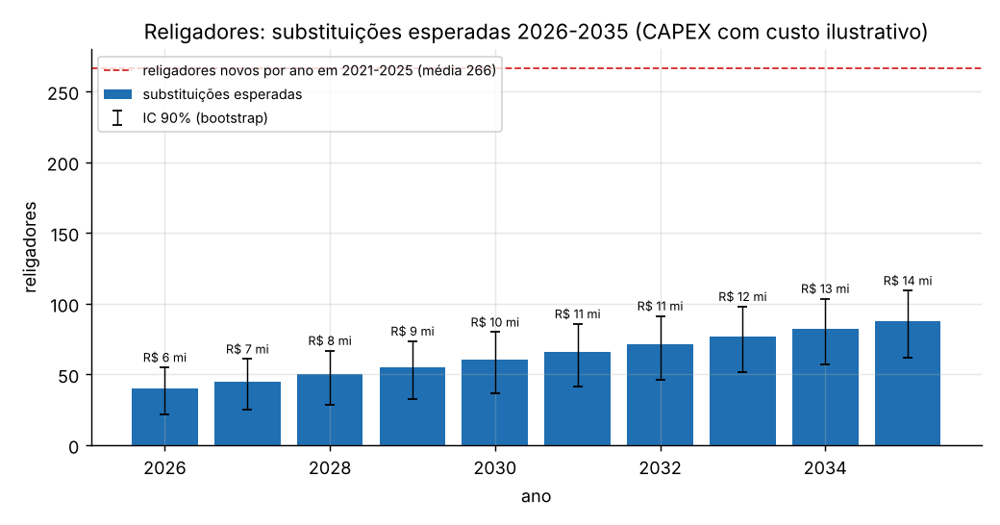
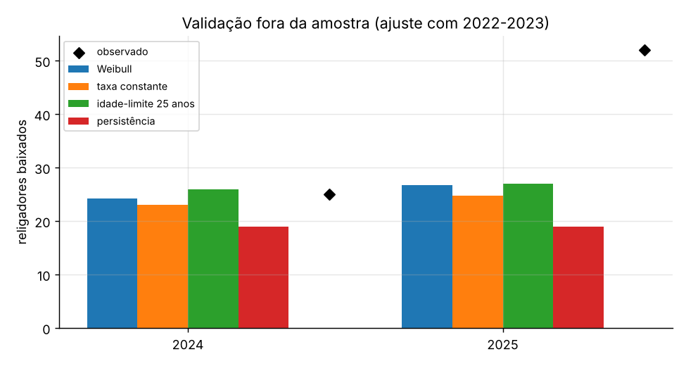
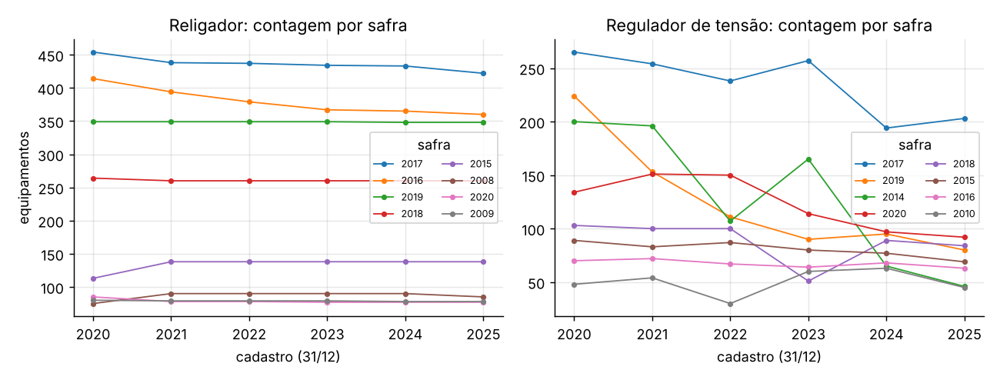

# Quanto tempo duram religadores e disjuntores, e quantos trocar por ano

[](https://github.com/CaioNepomuceno2/switchgear-survival/actions/workflows/ci.yml)


**Quanto tempo religadores, disjuntores, chaves e reguladores duram na rede da Energisa Mato Grosso, quantos
precisarão ser substituídos por ano e quanto isso custa?**

A base são os oito cadastros anuais da rede (BDGD/ANEEL, 31/12 de 2018 a 2025). Contei, em cada cadastro,
quantos equipamentos existem de cada ano de imobilização (a "safra"). Uma safra só perde equipamentos com o
tempo, e essa queda é a baixa. Com as baixas por idade, montei a tábua de vida de cada classe e ajustei uma
curva de Weibull, o método atuarial usado em estudos de depreciação de concessionárias.

## Resultados em uma tela

| | Religadores | Disjuntores de MT |
|---|---|---|
| Frota no cadastro de 2025 | 3.556 | 678 |
| Idade média da frota em 2025 | 7,3 anos | 13,0 anos |
| Taxa anual de baixa observada (2022-2025) | **1,0%** (IC 90%: 0,6% a 1,6%) | **1,2%** (IC 90%: 0,6% a 1,8%) |
| Vida mediana estimada (Weibull) | **28 anos** (IC 90%: 25 a 33) | **39 anos** (IC 90%: 32 a 55) |
| Ainda em operação aos 24 anos (observado) | 56% | 86% (aos 23 anos) |
| Substituições esperadas 2026-2035 | **635** (IC 90%: 404 a 822), 18% da frota | **102** (IC 90%: 60 a 145) |
| CAPEX de substituição 2026-2035 | **R$ 102 mi** com custo ilustrativo de R$ 160 mil por religador | sem custo configurado |

* **O risco de baixa cresce com a idade.** Nos religadores, a taxa anual é de 0,1% até 4 anos, 4,3% entre 15 e
  19 anos e 15,6% acima de 30 anos. A curva de Weibull tem β = 2,6 (IC 90%: 2,0 a 3,9). β acima de 1 indica
  desgaste: o equipamento fica mais propenso a sair da rede à medida que envelhece.
* **A frota de religadores é jovem e vai envelhecer.** Só 4% têm 20 anos ou mais. A necessidade de substituição
  sobe de 40 por ano em 2026 para 88 por ano em 2035. Hoje, a rede ganha em média 266 religadores novos por ano,
  então a reposição ainda é pequena perto da expansão, mas vai crescer.
* **Trocar por idade fixa erra o alvo.** Na validação fora da amostra, a regra "trocar ao completar 25 anos" não
  acertou nenhuma das 77 baixas reais de religadores em 2024-2025 (0% de acerto por safra). A curva de Weibull
  acertou 24% e a taxa constante, 18%. Os três métodos subestimaram o total, porque 2025 teve um salto de baixas.
* **Chaves e reguladores não têm dado confiável para estimar vida.** Nos reguladores, 59% das safras voltam a
  crescer depois de cair, o que é impossível numa frota real. A "vida mediana" calculada seria de 5 anos, um
  valor implausível. Nas chaves, os acréscimos em safras antigas equivalem a 37% das baixas. Essas duas
  classes ficam só no diagnóstico de qualidade.



## Na prática: o que muda para quem decide

### O problema hoje

* **Substituição reativa ou por idade fixa.** Sem uma curva de vida da própria frota, a troca acontece quando o
  equipamento falha ou quando atinge uma idade de referência. A validação mostra que a idade fixa de 25 anos não
  coincidiu com nenhuma das 77 baixas reais de religadores em 2024-2025.
* **Orçamento sem curva.** O plano de investimento precisa dizer quantas substituições virão nos próximos 10 anos.
  Sem a curva, o número vira um percentual chutado sobre a frota.
* **Cadastro com idades instáveis.** A data de imobilização do mesmo religador (mesmo código) muda de um cadastro
  para o outro em 50% a 95% dos casos. Quem tenta calcular idade equipamento a equipamento com a BDGD chega a
  conclusões erradas sem perceber.

### O que se ganha

| Ganho | Quanto | De onde vem o número |
|---|---|---|
| Vida mediana dos religadores com intervalo | 28 anos (25 a 33) | Medido: tábua de vida e Weibull com 118 baixas em 11.828 equipamentos-ano |
| Curva de risco por idade | de 0,1%/ano (0-4 anos) a 15,6%/ano (30+ anos) | Medido |
| Volume de substituições 2026-2035 | 635 religadores (404 a 822) | Modelo, extrapolado da curva medida; não inclui expansão |
| Orçamento de substituição | R$ 102 mi em 10 anos (R$ 6 mi em 2026, R$ 14 mi em 2035) | **Premissa**: custo ilustrativo de R$ 160 mil por religador |
| Lista de quem trocar primeiro | safras de 15+ anos concentram o risco | Medido (taxa por faixa de idade) |
| Diagnóstico do cadastro | classes confiáveis e não confiáveis, com métricas | Medido |

### Por que aplicar

* **Plano de investimento defensável.** Uma curva de sobrevivência com intervalo de confiança sustenta o volume
  de substituições pedido no plano de obras melhor que um percentual fixo.
* **Base de remuneração e depreciação.** A vida útil regulatória dos equipamentos é definida pela ANEEL no manual
  de controle patrimonial. Comparar a vida observada com a regulatória mostra se a frota é trocada antes ou depois
  do fim da depreciação. O parâmetro está em `configs/premissas.yaml` e segue em branco: tentei ler a Tabela XVI do
  manual (anexo da REN 674/2015), mas o site da ANEEL recusou o acesso automatizado, e não usei cópias de terceiros.
  O código ainda não lê esse parâmetro.
* **Risco de falha.** A taxa de 4,3% ao ano entre 15 e 19 anos indica onde está o risco hoje: as safras de 2006
  a 2010, que entram nessa faixa agora.
* **Qualidade do cadastro.** O diagnóstico aponta exatamente quais campos e classes da BDGD não sustentam análise
  de idade, o que orienta a correção cadastral antes da próxima entrega à ANEEL.

### Como aplicar

1. **Trocar a safra contábil pela data real do equipamento.** O cadastro patrimonial (ERP) tem a data de compra,
   o fabricante, o modelo e o número de série. Com esses dados, a análise passa a ser equipamento a equipamento
   (Kaplan-Meier com entrada tardia, já descrito em [docs/metodologia.md](docs/metodologia.md)), e dá para
   estimar a vida por fabricante e por tecnologia.
2. **Somar o histórico do SCADA.** Contadores de operação do religador, alarmes de manutenção (bateria, gás,
   falha de comando) e a disponibilidade da comunicação viram covariáveis num modelo de risco proporcional (Cox).
   A pergunta muda de "quantos trocar" para "quais trocar".
3. **Usar o histórico de ordens de manutenção.** Separar baixa por falha, por obra de melhoria e por remanejamento
   (o equipamento retirado de um ponto e instalado em outro não é uma baixa de vida útil).
4. **Piloto.** Escolher uma regional, montar a lista de religadores com 15 anos ou mais e confrontar com o estado
   real em campo (inspeção e teste). O critério de sucesso: a lista concentra mais falhas e reprovações em teste
   do que uma lista por idade fixa.
5. **Rotina anual.** Rodar o pipeline a cada novo cadastro (31/12), atualizar a curva e publicar no Power BI a
   tabela `reports/projecao.csv` (substituições e CAPEX por ano) e `reports/taxa_por_faixa.csv`.

### Limites de uso

* A projeção não inclui expansão da rede, só a reposição da frota existente.
* A vida mediana dos disjuntores (39 anos) está além da idade máxima observada com exposição relevante
  (23 anos): é extrapolação da curva. A dos religadores (28 anos) também passa da idade em que a observação é
  densa (24 anos).
* "Baixa" no cadastro inclui remanejamento e correção cadastral, não só fim de vida.
* O custo de R$ 160 mil por religador é ilustrativo (a mesma premissa do projeto
  [automation-impact](https://github.com/CaioNepomuceno2/automation-impact)). Use o banco de preços da empresa.

## Metodologia em resumo

Detalhes, fórmulas e uma explicação didática de truncamento e censura em [docs/metodologia.md](docs/metodologia.md).

1. **Classes pelo TUC.** Cada equipamento da BDGD tem um Tipo de Unidade de Cadastro: 345 religador, 210 disjuntor,
   160 chave, 340 regulador. Os códigos 160 e 210 conferem com o Banco de Preços de Referência da ANEEL; 345 e 340
   conferem com a ligação na própria BDGD (as unidades de religador têm equipamentos 345; a camada de reguladores
   tem 340).
2. **Safra.** O ano da data de imobilização (DAT_IMO). Os cadastros de 2018 e 2019 trazem a data-padrão 01/01/1920
   em 100% dos equipamentos e ficam de fora.
3. **Movimentos.** Para cada safra e par de cadastros consecutivos: expostos = contagem no início, baixas = queda
   da contagem, acréscimos = aumento numa safra antiga (correção cadastral).
4. **Teste de consistência.** Uma classe só entra na estimativa se os acréscimos em safras antigas forem no máximo
   25% das baixas e se no máximo 10% das safras voltarem a crescer depois de cair.
5. **Tábua de vida e Weibull.** Taxa de baixa por idade, sobrevivência acumulada com IC de Greenwood e Weibull por
   máxima verossimilhança binomial. IC 90% por bootstrap de safras (500 reamostragens).
6. **Janela principal.** Transições 2021→2022 a 2024→2025. A transição 2020→2021 tem, nos religadores, 60
   acréscimos em safras antigas para 56 baixas (recadastramento) e entra só como sensibilidade.
7. **Validação.** Ajuste com as transições até 2023 e previsão das baixas de 2024 e 2025, contra taxa constante,
   idade-limite de 25 anos e persistência.
8. **Projeção.** A frota de 2025 envelhece ano a ano pela curva e cada baixa é reposta por um equipamento novo.

## Resultados detalhados

### O risco cresce com a idade



| Idade (anos) | Religadores: baixas/expostos | Taxa anual | Disjuntores: baixas/expostos | Taxa anual |
|---|---|---|---|---|
| 0-4 | 4 / 4.950 | 0,1% | 1 / 456 | 0,2% |
| 5-9 | 50 / 4.434 | 1,1% | 7 / 585 | 1,2% |
| 10-14 | 4 / 1.052 | 0,4% | 0 / 352 | 0,0% |
| 15-19 | 36 / 830 | 4,3% | 1 / 254 | 0,4% |
| 20-24 | 14 / 437 | 3,2% | 2 / 229 | 0,9% |
| 25-29 | 5 / 93 | 5,4% | 7 / 147 | 4,8% |
| 30+ | 5 / 32 | 15,6% | 7 / 113 | 6,2% |

O que isso significa: nos religadores, o risco dá um salto a partir dos 15 anos. A faixa de 5 a 9 anos também tem
baixas acima do esperado, concentradas nas grandes safras de 2016 e 2017 (o que pode ser falha precoce de um lote ou
remanejamento; o cadastro não distingue). Nos disjuntores, o desgaste aparece mais tarde, a partir dos 25 anos.

### A frota em 2025



| | Religadores | Disjuntores |
|---|---|---|
| Idade mediana | 7 anos | 11 anos |
| Com 10 anos ou mais | 21% | 54% |
| Com 20 anos ou mais | 4,2% | 20,7% |
| Acima da vida mediana estimada | 0,3% | 2,6% |

Nos religadores, o meio de isolação mais comum é o código VC (vácuo), com o código GV ganhando espaço nas safras
dos anos 2010 e 2020. O próprio campo, porém, foi reclassificado entre cadastros (o código SE caiu de 205 para 6
equipamentos entre 2023 e 2025, enquanto GV subiu de 36 para 546), então não estimei a vida por tecnologia.

### Projeção 2026-2035



| Ano | Religadores substituídos | IC 90% | CAPEX ilustrativo |
|---|---|---|---|
| 2026 | 40 | 22 a 55 | R$ 6,4 mi |
| 2028 | 50 | 29 a 67 | R$ 8,0 mi |
| 2030 | 61 | 37 a 80 | R$ 9,7 mi |
| 2035 | 88 | 62 a 109 | R$ 14,0 mi |
| **2026-2035** | **635** | **404 a 822** | **R$ 102 mi** |

O que isso significa: a reposição de religadores mais que dobra em 10 anos só pelo envelhecimento da frota atual.
Para os disjuntores, são cerca de 8 a 12 substituições por ano (102 no período).

### Validação fora da amostra



| Religadores | Previsto 2024-2025 | Observado | Erro absoluto médio por ano | Acerto por safra |
|---|---|---|---|---|
| Weibull | 51 | 77 | 13,1 | **24%** |
| Taxa constante | 48 | 77 | 14,6 | 18% |
| Idade-limite 25 anos | 53 | 77 | 13,0 | 0% |
| Persistência | 38 | 77 | 19,5 | - |

Com um segundo desenho (ajuste até 2024, teste em 2025), o padrão se repete: 52 baixas observadas; Weibull prevê 28,
taxa constante 26 e idade-limite 27; acerto por safra de 27%, 17% e 0%.

O que isso significa: com só duas ou três transições para ajustar, nenhum método acerta o volume de um ano atípico
(2025 teve 52 baixas, mais que o dobro da média de 22 por ano em 2022-2024; 23 delas em religadores com 15 a 19 anos). O que a curva entrega
é a alocação: ela põe as baixas esperadas nas safras certas mais vezes que as alternativas, e a idade-limite não
acerta nenhuma. A previsão de volume melhora a cada cadastro novo incorporado. Nos disjuntores, com 20 baixas no
teste, nenhum método funcionou (acerto por safra de no máximo 7%).

### Diagnóstico do cadastro



| Classe | Frota 2025 | Sem data válida | Acréscimos em safras antigas / baixas | Safras que voltam a crescer | Usada na estimativa |
|---|---|---|---|---|---|
| Religador | 3.556 | 0,3% | 0% | 0% | sim |
| Disjuntor | 678 | 14,3% | 0% | 0% | sim |
| Chave | 264.931 | 2,1% | 37% | 16% | não |
| Regulador | 1.838 | 0% | 21% | 59% | não |

**Rastrear equipamento a equipamento não funciona com a BDGD da EMT.** Nos religadores:

| Transição | Códigos que reaparecem | Mesma data de imobilização, entre os que reaparecem |
|---|---|---|
| 2020→2021 | 97% | 29% |
| 2021→2022 | 96% | 5% |
| 2022→2023 | 28% (renumeração em massa) | 50% |
| 2023→2024 | 70% | 9% |
| 2024→2025 | 72% | 16% |

Os **pontos** de religador (a unidade de seccionamento no mapa) são estáveis quando casados por código e, nos anos
de renumeração, pela posição a até 30 m: em 2019→2020, 1.898 dos 2.638 pontos só casaram pela posição; em
2022→2023, 2.485 de 3.298. Os pontos que somem sem par (34, 34, 93, 51 e 83 por ano de 2020 a 2025) têm a mesma
ordem de grandeza das baixas contábeis (19 a 52 por ano), o que reforça a leitura por safra.

## Reproduzir

```bash
pip install -e ".[dev,dados]"
python scripts/00_baixar_bdgd.py     # 8 cadastros da BDGD (~1 GB cada, processados e apagados um a um)
python scripts/01_painel.py          # matriz safra x cadastro e diagnóstico do cadastro
python scripts/02_vida.py            # tábua de vida, Weibull, bootstrap e idade da frota
python scripts/03_validacao.py       # validação fora da amostra
python scripts/04_projecao.py        # substituições e CAPEX 2026-2035
python scripts/05_figuras.py
pytest
```

As premissas (classes, janelas, limiares de qualidade, custos e vida regulatória) ficam em
[`configs/premissas.yaml`](configs/premissas.yaml).

O cache da BDGD (`scripts/00_baixar_bdgd.py` grava um Parquet por camada e ano) fica por padrão em `data/cache`,
dentro do projeto, e a pasta está no `.gitignore`. Para usar outro disco, defina `SWSURV_CACHE` antes de rodar
os scripts; a variável vale mais que o YAML, e caminho relativo conta a partir da raiz do projeto:

```bash
export SWSURV_CACHE=/dados/bdgd-cache          # bash
```

```powershell
$env:SWSURV_CACHE = "D:\dados\bdgd-cache"      # PowerShell
```

O `pytest` não baixa nada: os testes montam cadastros sintéticos minúsculos numa pasta temporária.

## Estrutura

```
src/swsurv/
  cadastro.py   leitura da BDGD, safras, matriz safra x cadastro, movimentos, diagnóstico e rastreamento
  atuarial.py   tábua de vida (Greenwood), Weibull por máxima verossimilhança, bootstrap por safra
  projecao.py   projeção com reposição, baselines da validação
scripts/        00 a 05, do download às figuras
configs/        premissas
docs/           metodologia
reports/        tabelas e figuras
```

## Limitações

* **Baixa contábil não é falha.** A queda numa safra inclui fim de vida, remanejamento entre pontos e correção
  cadastral. O cadastro não diz o motivo.
* **Contagem líquida.** Se uma safra perde e ganha equipamentos no mesmo ano, o cadastro só mostra a diferença, e
  as baixas ficam subestimadas.
* **Janela curta.** Quatro transições (2022 a 2025), com 118 baixas de religadores e 25 de disjuntores. Os
  intervalos são largos, e a vida mediana dos disjuntores é extrapolação.
* **Sensibilidade à transição 2020→2021.** Com ela, a vida mediana dos religadores muda pouco (31 anos), mas a dos
  disjuntores cai para 24 anos, por causa de 79 baixas concentradas naquele ano.
* **Sem estratificação por tecnologia, corrente nominal ou telecomando.** Esses atributos não ficam presos à safra
  de forma estável no cadastro.
* **Equipamentos sem data.** A projeção reescala os 14% de disjuntores sem data válida supondo a mesma distribuição
  de idade dos datados.
* **Interrupções não foram ligadas à idade.** O dado de 2026 traz o tipo de equipamento que atuou, mas não o
  equipamento, e a idade individual não é confiável.
* **Custos e vida regulatória.** O custo do religador é ilustrativo. A vida regulatória segue em branco: o PDF da
  Tabela XVI do manual de controle patrimonial não pôde ser lido (HTTP 403 do site da ANEEL) e nenhum valor foi
  estimado.

---
Autor: **Caio Nepomuceno**. Dados públicos da ANEEL (BDGD). Projeto independente, sem vínculo com a Energisa ou com a
ANEEL.
