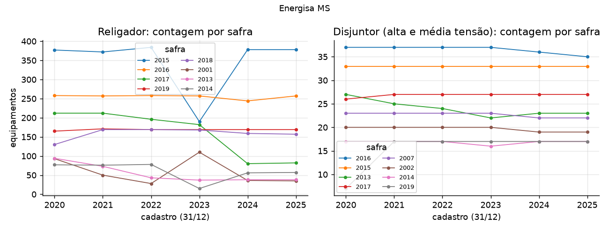
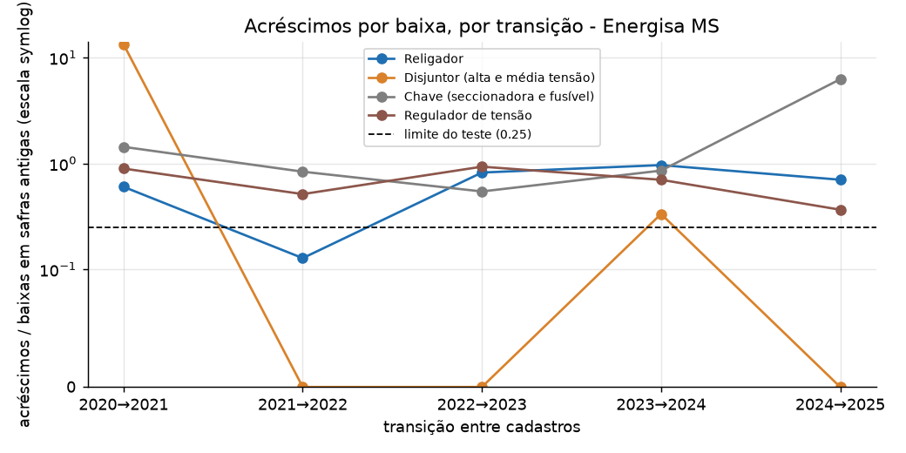

# Resultados da Energisa MS

**O cadastro da Energisa MS (BDGD de 2018 a 2025) não passa no teste de consistência em nenhuma das quatro classes.**
Por isso este repositório **não publica vida mediana, curva de sobrevivência nem projeção de trocas para MS**. O que sai
é um diagnóstico do cadastro: quais classes existem, quanto o cadastro oscila de um ano para o outro e por que a
contagem de baixas por safra não mede vida útil em MS.

As decisões de dados (anos com data, classes, limiares, janelas) foram escritas e commitadas antes de qualquer
resultado, em [decisoes_ems.md](decisoes_ems.md). Todo número abaixo sai de um arquivo regenerado em
[`reports/ems/`](../reports/ems/). Comparações com MT são só descritivas.

> Projeto independente, sem vínculo com a Energisa ou com a ANEEL. Só dados abertos (BDGD da ANEEL).

## Destaques

| | Religador | Disjuntor | Chave | Regulador |
|---|---|---|---|---|
| TUC | 345 | 210 | 160 | 340 |
| Frota no cadastro de 2025 | 2.654 | 455 | 98.745 | 946 |
| Equipamentos sem data válida em 2025 | 0% | 0% | 0% | 0% |
| Baixas observadas, 2021→2025 (contagem líquida por safra) | 790 | 49 | 59.660 | 368 |
| Acréscimos em safras antigas no mesmo período | 550 | 6 | 53.018 | 241 |
| Acréscimos por baixa (limite do teste: 0,25) | **0,696** | 0,122 | **0,889** | **0,655** |
| Safras que voltam a subir depois de cair (limite: 10%) | **75,9%** (22 de 29) | **12,5%** (2 de 16) | **93,3%** (42 de 45) | **52,6%** (10 de 19) |
| Passa no teste de consistência | não | não | não | não |
| Vida mediana, com intervalo | não estimada | não estimada | não estimada | não estimada |
| Substituições esperadas 2026-2035 | não feita | não feita | não feita | não feita |
| Custo ilustrativo de substituição | não calculado | não calculado | não calculado | não calculado |

(`reports/ems/qualidade_classes.csv`.) O teste reprova uma classe se os acréscimos passam de 25% das baixas ou se mais
de 10% das safras com 10 equipamentos ou mais voltam a subir depois de cair. São os mesmos limites de MT, e nenhuma
janela de ajuste que os dados permitem aprova alguma classe (`reports/ems/diagnostico/janelas_candidatas.csv`, seção 5
de [decisoes_ems.md](decisoes_ems.md)).

* **A baixa que o cadastro mostra não parece ser retirada de equipamento.** Numa frota real, uma safra só perde equipamentos. Em
  MS a contagem por safra sobe e desce: no religador, a safra de 2015 tem 377, 372, 384, **190**, 378 e 378 equipamentos
  de 2020 a 2025, e a de 2017 cai de 182 para 80 em 2024
  (`reports/ems/diagnostico/safras_principais.csv`). A queda de 2023 na safra de 2015 volta no ano seguinte.
* **O disjuntor reprova por pouco, e a razão é pequena.** Passa no critério de acréscimos (0,122) e reprova no de safras
  que voltam a subir (2 de 16). As duas safras são 2013 (25, 24, 22, 23, 23 equipamentos) e 2014 (17, 17, 16, 17, 17),
  que oscilam em um equipamento. O limiar não foi movido (decisão 5 de [decisoes_ems.md](decisoes_ems.md)), e o disjuntor
  fica sem estimativa. Tem só 49 baixas em quatro transições, de qualquer forma.
* **Os ajustes de Weibull existem, mas não valem.** `vida_weibull.csv` traz o ajuste das quatro classes, todas com
  `confiavel = False` e sem intervalo de confiança (o bootstrap só roda para classe que passa no teste). Eles ajustam
  baixas que o próprio cadastro desmente: o religador daria 11 anos de vida mediana e as chaves 5, com 550 e 53.018
  acréscimos para 790 e 59.660 baixas. Não são estimativas de vida.





## As datas do cadastro não acompanham o equipamento

O mesmo religador (mesmo `COD_ID`) com a mesma safra no cadastro anterior e no seguinte tem outra safra no cadastro
do meio em 57% dos casos em 2023 (212 de 372) e em 38% em 2024, e em 54% a 73% das chaves de 2021 a 2024
(`reports/ems/diagnostico/vai_e_volta_das_datas.csv`). Nos disjuntores a taxa é de 3% a 14% (2022 a 2024).

Rastreamento por código (`reports/ems/qualidade_ids.csv` e, para MT, `reports/qualidade_ids.csv`), religadores:

| Transição | MS: códigos que reaparecem | MS: mesma data de imobilização | MT: códigos que reaparecem | MT: mesma data |
|---|---|---|---|---|
| 2020→2021 | 43% | 27% | 97% | 29% |
| 2021→2022 | 71% | 10% | 96% | 5% |
| 2022→2023 | 97% | 16% | 28% (renumeração em massa) | 50% |
| 2023→2024 | 95% | 9% | 70% | 9% |
| 2024→2025 | 96% | 27% | 72% | 16% |

Nos dois cadastros a data de imobilização do mesmo código muda de um ano para o outro na maior parte dos casos, e há
anos de renumeração em massa dos códigos (MS: 2020→2021, com 43% dos códigos reaparecendo, e em parte 2021→2022, com
71%; MT: 2022→2023, com 28%). A diferença está na contagem por safra: em MT ela fica estável, em MS ela oscila.

## Baixas contábeis contra pontos retirados

Os pontos de religador (a unidade no mapa, `UNSEMT` com `TIP_UNID` 32) são rastreados por código e, quando o código
não reaparece, pela posição a até 30 m (`reports/ems/qualidade_pontos_religador.csv`). Os pontos que somem sem par
são poucos, perto das baixas de religadores por safra:

| Transição | Baixas de religadores (por safra) | Acréscimos em safras antigas | Pontos retirados (sem par) | Pontos novos |
|---|---|---|---|---|
| 2020→2021 | 118 | 71 | 10 | 70 |
| 2021→2022 | 188 | 24 | 21 | 155 |
| 2022→2023 | 296 | 243 | 3 | 67 |
| 2023→2024 | 259 | 250 | 5 | 69 |
| 2024→2025 | 47 | 33 | 5 | 338 |

(Baixas e acréscimos: `reports/ems/diagnostico/transicoes.csv`.) Os dois números não medem a mesma coisa: um ponto pode
continuar no mapa com outro equipamento. Mesmo assim, 296 baixas de 2.100 religadores em um ano (14%), contra 3 pontos
retirados, indica que boa parte da "baixa" é troca de data no cadastro, e não retirada de rede (o cadastro não diz o
motivo). Em MT, os pontos
retirados (34 a 93 por ano, `reports/qualidade_pontos_religador.csv`) têm a mesma ordem de grandeza das baixas por
safra (19 a 52 por ano, segundo o README de MT).

## Frota e idade

| | 2020 | 2021 | 2022 | 2023 | 2024 | 2025 |
|---|---|---|---|---|---|---|
| Religador | 1.898 | 1.959 | 2.100 | 2.174 | 2.254 | 2.654 |
| Disjuntor | 386 | 403 | 435 | 422 | 445 | 455 |
| Chave (TUC 160) | 70.855 | 74.124 | 77.199 | 83.061 | 86.598 | 98.745 |
| Regulador | 596 | 658 | 720 | 783 | 873 | 946 |

(`reports/ems/frota_por_ano.csv`.) A idade do cadastro de 2025 é só indicativa, porque as datas mudam de um cadastro
para o outro (`reports/ems/idade_frota_2025.csv`):

| | Religador | Disjuntor | Chave | Regulador |
|---|---|---|---|---|
| Idade média (anos) | 7,7 | 13,0 | 9,0 | 5,8 |
| Idade mediana (anos) | 7 | 10 | 8 | 4 |
| Com 10 anos ou mais | 33% | 53% | 37% | 18% |
| Com 20 anos ou mais | 8,6% | 25,9% | 6,1% | 1,3% |

A frota de religadores cresceu 40% de 2020 a 2025 (1.898 para 2.654); a de chaves, 39%.

## Comparação descritiva com MT

Os mesmos indicadores do teste de consistência, nos arquivos publicados de cada distribuidora
(`reports/qualidade_classes.csv` e `reports/ems/qualidade_classes.csv`):

| Classe | Frota 2025: MT | Frota 2025: MS | Acréscimos por baixa: MT | MS | Safras que voltam a subir: MT | MS | Passa no teste: MT | MS |
|---|---|---|---|---|---|---|---|---|
| Religador | 3.556 | 2.654 | 0,000 | 0,696 | 0,0% | 75,9% | sim | não |
| Disjuntor (TUC 210) | 678 | 455 | 0,000 | 0,122 | 0,0% | 12,5% | sim | não |
| Chave | 264.931 | 98.745 | 0,372 | 0,889 | 16,3% | 93,3% | não | não |
| Regulador | 1.838 | 946 | 0,208 | 0,655 | 58,8% | 52,6% | não | não |

Em MT, religador e disjuntor passam no teste, com zero acréscimos em safras antigas na janela principal. Em MS nenhuma
classe passa. A comparação não diz a causa: pode ser a forma como cada cadastro é preenchido, o processo de
recadastramento ou outro fator. Uma comparação normalizada por consumidor e por km de rede fica para o comparativo MT × MS.

## Limitações próprias de MS

* **Janela curta.** Só 2020 a 2025 têm data de imobilização válida (2018 e 2019 trazem `01/01/1920` em 100% dos
  equipamentos das quatro classes): são cinco transições, e a principal usa quatro. A transição 2020→2021 é o ano em
  que as datas começam a ser preenchidas (disjuntores datados: 343 de 386 em 2020), e entra só como sensibilidade.
* **Contagem líquida.** A contagem por safra só mostra a diferença entre dois cadastros. Se uma safra perde e ganha
  equipamentos no mesmo ano, as baixas ficam subestimadas e os acréscimos escondem trocas. Em MS isso se soma à troca
  de data do mesmo equipamento.
* **Equipamentos sem data.** Nas quatro classes, 100% dos equipamentos têm data válida em 2025, mas a classe "chave"
  (TUC 160) cobre só 98.745 dos 346.980 equipamentos da `EQSE` de 2025 (28%). Outros 245.126 (71%) estão no TUC 000 e
  não têm data. A classe também muda de composição: a maior parte das chaves fusíveis sai do TUC 160 para o 000 entre
  2019 e 2020.
* **Datas instáveis.** A data de imobilização do mesmo equipamento muda na maior parte dos casos de um cadastro para o
  seguinte (seção acima), e a contagem por safra oscila em mais de uma safra e mais de um ano, não só em 2023.
* **Disjuntor inclui alta tensão.** 316 dos 455 equipamentos TUC 210 de 2025 são de alta tensão (`GRU_TEN` = AT).
* **Vida útil regulatória em branco**, como em MT: o PDF da Tabela XVI do Manual de Controle Patrimonial não pôde ser
  lido (HTTP 403 do site da ANEEL) e nenhum valor foi estimado.
* **Sem interrupções.** Este repositório não liga idade a falhas, nem em MT.

## O que faria a estimativa de MS possível

Nada disto foi feito aqui, e cada item precisa de dado ou de decisão que não está no cadastro aberto.

1. **Data de compra por equipamento**, do cadastro patrimonial (ERP) da distribuidora, no lugar da data de imobilização
   do cadastro, que não acompanha o equipamento.
2. **Conferir a versão de 17/12/2024 do snapshot de 2023** (`b8c585ae35224ac8aa0648587ec61bcb`), que não é a mais
   recente e por isso não foi usada. O cadastro de 2023 é o de maior queda e volta nos religadores; a versão antiga pode
   ou não ter o mesmo problema. Seria um teste novo, e a regra de usar a versão mais recente de cada ano é da
   configuração.
3. **Uma tolerância no teste de consistência.** O critério de safras que voltam a subir marca o disjuntor por uma
   oscilação de um equipamento. Uma tolerância em número de equipamentos pode ser razoável, mas precisa ser fixada antes
   de ser aplicada a MS e testada também em MT.

## Arquivos

* `reports/ems/qualidade_classes.csv`, `qualidade_ids.csv`, `qualidade_pontos_religador.csv`, `frota_por_ano.csv`,
  `idade_frota_2025.csv`: o diagnóstico do cadastro.
* `reports/ems/vida_weibull.csv`, `tabua_<classe>.csv`, `validacao*.csv`, `tecnologia_religador_2025.csv`: os cálculos
  que rodam para todas as classes, todos com `confiavel = False`; **não são estimativas de MS**.
* `reports/ems/projecao.csv`, `projecao_resumo.csv`, `taxa_por_faixa.csv`: só com o cabeçalho, porque nenhuma classe passa
  no teste.
* `reports/ems/diagnostico/`: os diagnósticos de dados em que se baseiam as decisões.
* `reports/ems/figures/`: frota por safra (03), contagem por safra (06) e acréscimos por baixa (07).

## Reproduzir

```bash
pip install -e ".[dev,dados]"
python scripts/00_baixar_bdgd.py --config configs/premissas_ems.yaml --zips <pasta dos zips>   # ou sem --zips: baixa
python scripts/diagnostico_bdgd.py --config configs/premissas_ems.yaml
python scripts/01_painel.py --config configs/premissas_ems.yaml
python scripts/02_vida.py --config configs/premissas_ems.yaml
python scripts/03_validacao.py --config configs/premissas_ems.yaml
python scripts/04_projecao.py --config configs/premissas_ems.yaml
python scripts/05_figuras.py --config configs/premissas_ems.yaml
```

O mesmo vale com `SWSURV_CONFIG=configs/premissas_ems.yaml` no lugar de `--config`. As saídas de MS ficam em
`reports/ems/` e `data/ems/processed/`, e o cache em `data/cache/ems/`; nada de MT é lido nem alterado.
